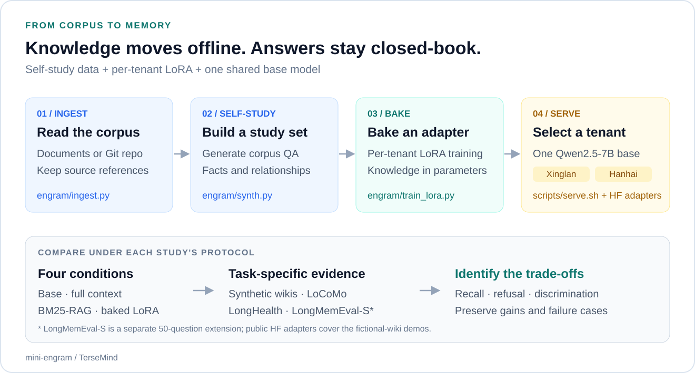
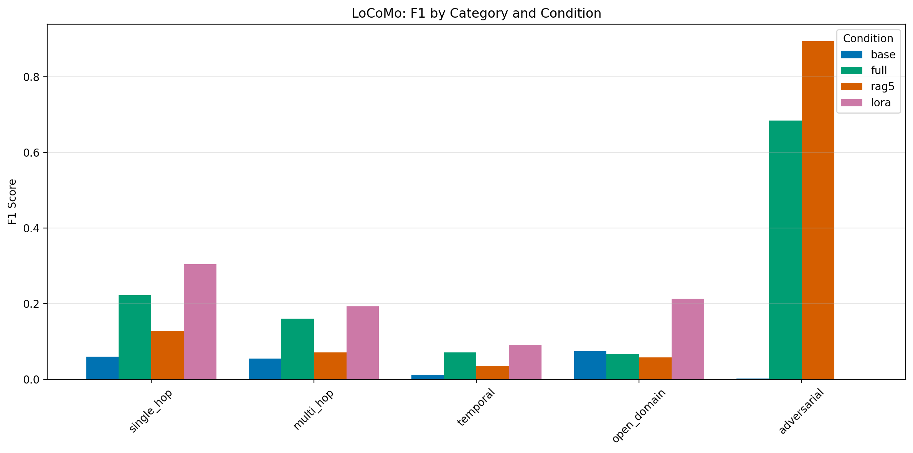
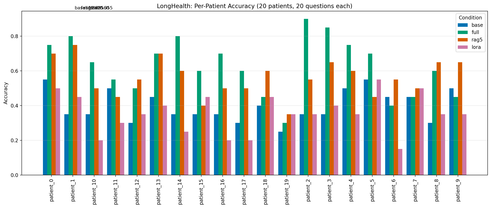

<h1 align="center">mini-engram</h1>

<p align="center"><strong>From Documents to Parametric Memory</strong></p>
<p align="center">Read the corpus. Generate the study set. Bake a memory adapter. Answer closed-book.</p>

<p align="center">
  <a href="#overview">Overview</a> ·
  <a href="#released-models"><strong>Models</strong></a> ·
  <a href="#memory-pipeline">Pipeline</a> ·
  <a href="#results">Results</a> ·
  <a href="#quick-start">Quick Start</a> ·
  <a href="docs/arxiv-submission-8110276/paper.pdf">Paper</a> ·
  <a href="README.zh-CN.md">简体中文</a>
</p>

<p align="center">
  <a href="requirements.txt"></a>
  <a href="https://huggingface.co/Qwen/Qwen2.5-7B-Instruct"></a>
  <a href="LICENSE"></a>
</p>

<p align="center">
  <a href="https://huggingface.co/tersemind/mini-engram-xinglan"></a>
  <a href="https://huggingface.co/tersemind/mini-engram-hanhai"></a>
</p>

## Overview

**mini-engram** is a minimal open reproduction of an Engram-style memory-baking pipeline: turn a tenant's documents into self-study question–answer pairs, train a LoRA adapter, then answer from the base model plus that adapter **without retrieving documents at inference time**.

The project connects **code, released memory adapters and comparative experiments**. It studies when baked knowledge helps factual recall, and when retrieval or reading the original context works better. One base model can host multiple tenant adapters through vLLM.

## Released Models

Two public Hugging Face releases let you try the fictional-company demos without training from scratch:

| Memory adapter | Base model | Published demo token-F1 |
| :--- | :--- | :--- |
| [**mini-engram-xinglan**](https://huggingface.co/tersemind/mini-engram-xinglan) · Xinglan Tech | Qwen2.5-7B-Instruct | Base **0.126** → adapter **0.666** |
| [**mini-engram-hanhai**](https://huggingface.co/tersemind/mini-engram-hanhai) · Hanhai Robotics | Qwen2.5-7B-Instruct | Base **0.113** → adapter **0.664** |

Each release is a **rank-16 LoRA adapter**, about **40.4M parameters / 81 MB in bf16**, to attach to the base model. These two demo adapters cover fictional company wikis; benchmark studies use their own tenant-specific adapters and recipes.

```python
from peft import PeftModel
from transformers import AutoModelForCausalLM

base = AutoModelForCausalLM.from_pretrained(
    "Qwen/Qwen2.5-7B-Instruct", device_map="auto", torch_dtype="auto"
)
model = PeftModel.from_pretrained(base, "tersemind/mini-engram-xinglan")
```

[**Model guide: pinned snapshots, generation example and dual-tenant serving →**](docs/MODELS.md)

## Memory Pipeline

<p align="center">
  <a href="docs/media/memory-pipeline.svg"></a>
</p>

<p align="center"><em>Knowledge is prepared offline, stored in adapter parameters and selected by tenant at serving time.</em></p>

| Stage | What happens | Entry point |
| :--- | :--- | :--- |
| **Ingest** | Local documents or a Git repository become text chunks. | [`engram/ingest.py`](engram/ingest.py) |
| **Self-study** | The base model synthesizes QA from the corpus; extended recipes target cross-session and update questions. | [`engram/synth.py`](engram/synth.py) |
| **Bake** | PEFT LoRA fine-tuning writes a separate adapter for each tenant. | [`engram/train_lora.py`](engram/train_lora.py) |
| **Serve** | One vLLM base process mounts multiple adapters; requests select a tenant model name. | [`scripts/serve.sh`](scripts/serve.sh) |
| **Compare** | Evaluate base, full-context, BM25-RAG and closed-book LoRA under each study's protocol. | [`engram/bench.py`](engram/bench.py) · [benchmark notes](docs/BENCHMARKS.md) |

## Results

Experiments use **Qwen2.5-7B-Instruct on an A10 24 GB GPU**. The table summarizes recorded project measurements; each row has its own metric and scope.

| Study | Metric and scope | Observation |
| :--- | :--- | :--- |
| **Synthetic wikis** | Own-tenant token-F1; two fictional companies | LoRA **0.666 / 0.664**, versus base **0.126 / 0.113** and full-context **0.349 / 0.349**. |
| **LoCoMo** | 10 conversations, 1,986 questions; factual-only aggregate excludes 446 adversarial questions | Factual-only token-F1: LoRA **0.234**, full-context **0.170**, BM25-RAG **0.093**. |
| **LoCoMo refusal** | Adversarial category, scored by refusal behavior | LoRA **0.000**, versus BM25-RAG **0.895**; overall F1 remains **0.181** for LoRA versus **0.285** for full-context. |
| **LongHealth** | 20 fictional patients, 400 multiple-choice questions | LoRA **0.355** accuracy, below full-context **0.625**, BM25-RAG **0.560** and base **0.398**. |
| **LongMemEval-S extension** | Project subset of **50 questions**, six-pass synthesis; LLM judge | LoRA **0.300**, BM25-RAG **0.200**, truncated full-context **0.160**. This is a small project study. |

### Factual recall and refusal are different behaviors

<p align="center">
  <a href="data/bench/figs/fig4_locomo_category.pdf"></a>
</p>

The LoCoMo result exposes the trade-off: the adapter improves several factual categories while failing to abstain on out-of-scope questions. LongHealth reverses the ordering, favoring full-context reading for fine-grained discrimination. Tenant routing, refusal calibration and broader forgetting checks remain part of a complete deployment.

<details>
<summary><strong>Inspect the LongHealth result and experimental boundaries</strong></summary>

<p align="center">
  <a href="data/bench/figs/fig6_longhealth.pdf"></a>
</p>

- The HF releases are wiki demo adapters, not the LoCoMo, LongHealth or LongMemEval-S research adapters.
- LongMemEval-S uses a 15-question development pilot and 35 held-out questions within the 50-question subset. Its full-context baseline uses a 32K-token chronological head; it is not a full-history upper bound.
- LongMemEval-S judging uses DeepSeek-v3.2 with the official templates and a three-vote majority. Its judge scores differ from the token-F1 and accuracy metrics of the other studies.
- Cross-tenant token-F1 is affected by short-answer overlap and generic knowledge; it does not establish an isolation guarantee. The recorded failure includes confident fabrication.
- Six general-capability probes are a limited check. Changed corpora require re-baking; incremental updates and comprehensive forgetting control are outside this minimal pipeline.
- Comparisons with published Mem0, Zep or Cartridges results use different models or protocols and do not establish a shared leaderboard ranking.

</details>

[**Full experiments and negative results →**](docs/BENCHMARKS.md) · [Aggregate JSON records](data/bench/)

## Quick Start

The study used a Linux NVIDIA/CUDA environment with an **A10 24 GB**. Set up the environment from the repository root:

```bash
git clone https://github.com/kangzhanhui/mini-engram.git
cd mini-engram
python3 -m venv .venv
source .venv/bin/activate
python -m pip install -r requirements.txt ninja huggingface_hub
```

**Try released weights:** follow the [model guide](docs/MODELS.md#serve-both-tenants-from-this-repository) to download both HF adapters and run `scripts/serve.sh`.

**Bake your own demo:** run the full corpus → synthesis → training → evaluation workflow:

```bash
bash scripts/run_demo.sh xinglan
```

<details>
<summary><strong>Use your own documents and serve a new tenant</strong></summary>

```bash
.venv/bin/python -m engram.ingest --tenant myteam --source /path/to/docs
.venv/bin/python -m engram.synth --tenant myteam
.venv/bin/python -m engram.train_lora --tenant myteam
.venv/bin/python -m engram.eval --tenant myteam

bash scripts/serve.sh
# In another terminal:
.venv/bin/python scripts/chat.py --tenant myteam "What is your reimbursement system called?"
```

`MINI_ENGRAM_BASE_MODEL` changes the training pipeline's default base model; `--model` selects a model for synthesis, training or evaluation. The project resolves model IDs through ModelScope by default. `scripts/serve.sh` accepts its base model/path as its first argument and port as its second.

The demo waits for GPU memory to be available before GPU stages. Training defaults are a runnable starting point; reproduce reported scores with the corresponding study recipe in the [benchmark notes](docs/BENCHMARKS.md).

</details>

## Paper and Resources

| Resource | Contents |
| :--- | :--- |
| [Paper PDF](docs/arxiv-submission-8110276/paper.pdf) · [Full source package](docs/arxiv-submission-8110276/submission-source.tar.gz) | Preserved 11-page, three-study arXiv submission snapshot. [Version and hashes](docs/arxiv-submission-8110276/). |
| [Hugging Face adapters](docs/MODELS.md) | Two demo checkpoints, pinned revisions and loading/serving examples. |
| [Benchmark notes](docs/BENCHMARKS.md) · [Result summaries](data/bench/) | Wiki, LoCoMo, LongHealth and the separate LongMemEval-S extension. |
| [Data notes](data/README.md) | Benchmark acquisition, derived artifacts and redistribution boundaries. |
| [Release checklist](RELEASE.md) | Historical release tasks and validation status. |

The paper link is a submission snapshot, not an announced arXiv publication. LongMemEval-S is a separate repository extension and is not included in that three-study paper.

## Repository

```text
├── engram/           # Ingestion, synthesis, LoRA training, scoring and benchmarks
├── scripts/          # Demo, multi-adapter serving and benchmark workflows
├── data/bench/       # Published aggregate results and research figures
├── docs/
│   ├── MODELS.md     # HF model inventory and inference guide
│   ├── BENCHMARKS.md # Detailed experiments and protocol notes
│   └── arxiv-submission-8110276/ # Preserved paper PDF and source package
└── requirements.txt
```

## Citation

```bibtex
@misc{kang2026miniengram,
  title = {Bake It or Retrieve It: Reproducing Engram-Style Parametric Memory
           and Benchmarking It Against Retrieval and Full-Context Baselines},
  author = {Kang, Zhanhui},
  year = {2026},
  url = {https://github.com/kangzhanhui/mini-engram}
}
```

## Acknowledgements and License

Related building blocks include [HazyResearch/cartridges](https://github.com/HazyResearch/cartridges), [SakanaAI/doc-to-lora](https://github.com/SakanaAI/doc-to-lora) and [Continual-Intelligence/SEAL](https://github.com/Continual-Intelligence/SEAL). mini-engram is an independent reproduction and study.

Project-owned code and contributions are **MIT**, Copyright (C) 2026 TerseMind. Released adapters derive from **Qwen2.5-7B-Instruct (Apache 2.0)** and retain its redistribution requirements. Third-party datasets have their own terms. See [LICENSE](LICENSE), [NOTICE.md](NOTICE.md) and the [model guide](docs/MODELS.md#use-and-redistribution).
