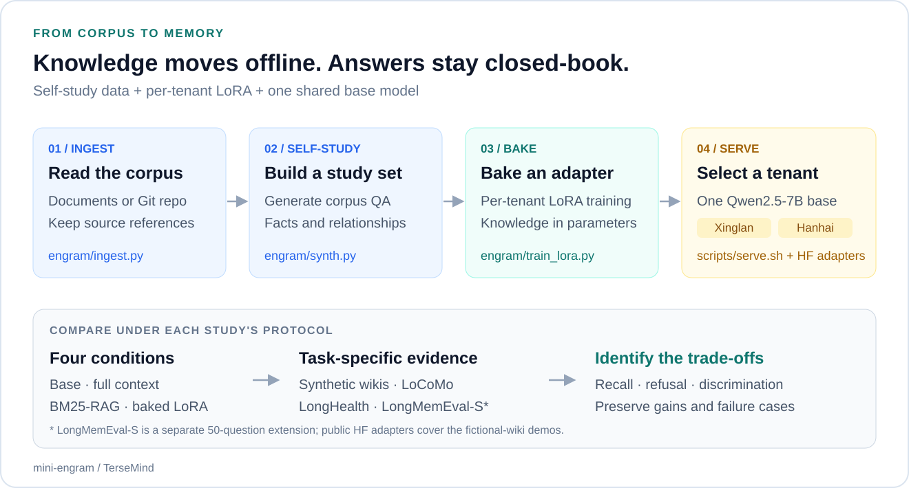
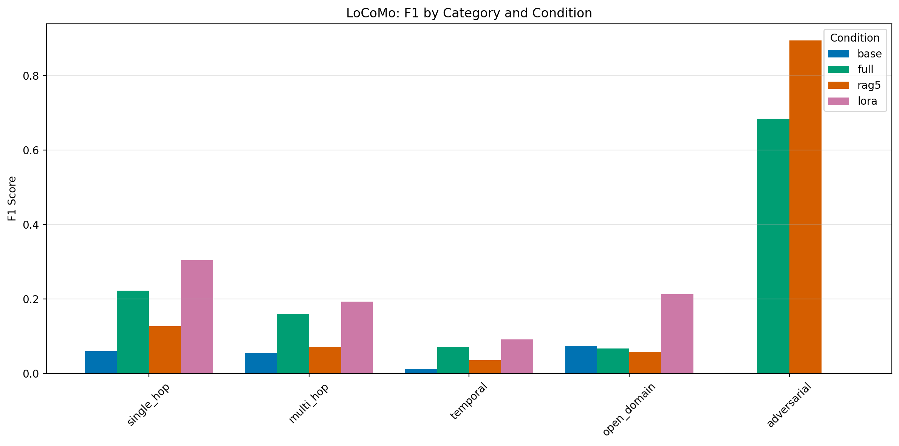
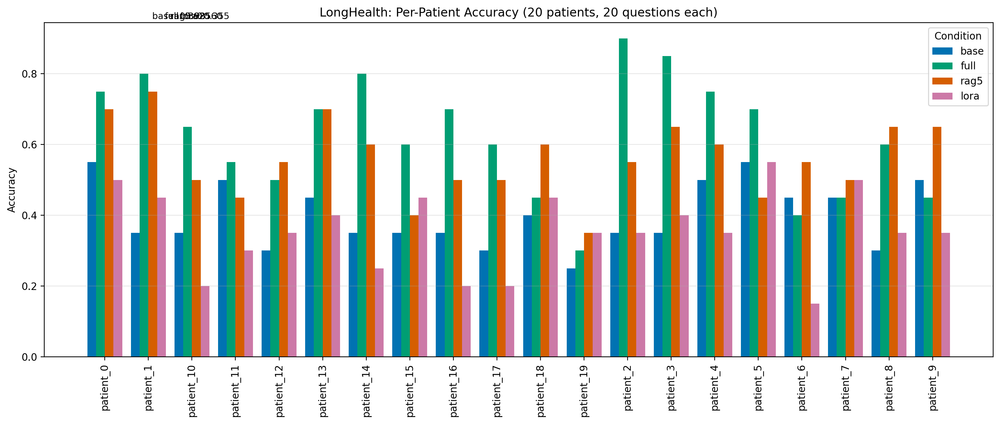

<h1 align="center">mini-engram</h1>

<p align="center"><strong>把文档知识写入模型参数</strong></p>
<p align="center">读取语料 · 合成学习材料 · 训练记忆适配器 · 闭卷回答</p>

<p align="center">
  <a href="#项目概览">项目概览</a> ·
  <a href="#开源模型"><strong>开源模型</strong></a> ·
  <a href="#记忆写入流程">记忆流程</a> ·
  <a href="#实验结果">实验结果</a> ·
  <a href="#快速开始">快速开始</a> ·
  <a href="docs/arxiv-submission-8110276/paper.pdf">论文</a> ·
  <a href="README.md">English</a>
</p>

<p align="center">
  <a href="requirements.txt"></a>
  <a href="https://huggingface.co/Qwen/Qwen2.5-7B-Instruct"></a>
  <a href="LICENSE"></a>
</p>

<p align="center">
  <a href="https://huggingface.co/tersemind/mini-engram-xinglan"></a>
  <a href="https://huggingface.co/tersemind/mini-engram-hanhai"></a>
</p>

## 项目概览

**mini-engram** 是 Engram 风格记忆写入流程的最小开源复现：从租户文档合成自学习问答，训练 LoRA 适配器，再通过基座＋该适配器回答问题，**推理时不检索原始文档**。

项目连接了**代码、开源记忆适配器与对比实验**，研究参数化记忆何时有利于事实召回，以及检索或直接阅读原文何时更有效。通过 vLLM，一个基座可以托管多个租户适配器。

## 开源模型

Hugging Face 上的两份公开权重可以直接用于虚构公司演示，无需从头训练：

| 记忆适配器 | 基座模型 | 模型卡报告的演示 token-F1 |
| :--- | :--- | :--- |
| [**mini-engram-xinglan**](https://huggingface.co/tersemind/mini-engram-xinglan) · 星澜科技 | Qwen2.5-7B-Instruct | 基座 **0.126** → 适配器 **0.666** |
| [**mini-engram-hanhai**](https://huggingface.co/tersemind/mini-engram-hanhai) · 瀚海机器人 | Qwen2.5-7B-Instruct | 基座 **0.113** → 适配器 **0.664** |

两者都是 **rank-16 LoRA 适配器**，各约 **4040 万参数、bf16 格式 81 MB**，需挂载到基座模型。它们学习的是虚构公司 wiki；各基准研究使用各自的租户适配器和训练配方。

```python
from peft import PeftModel
from transformers import AutoModelForCausalLM

base = AutoModelForCausalLM.from_pretrained(
    "Qwen/Qwen2.5-7B-Instruct", device_map="auto", torch_dtype="auto"
)
model = PeftModel.from_pretrained(base, "tersemind/mini-engram-xinglan")
```

[**模型指南：固定版本、生成示例与双租户托管 →**](docs/MODELS.md)

## 记忆写入流程

<p align="center">
  <a href="docs/media/memory-pipeline.svg"></a>
</p>

<p align="center"><em>离线准备知识，将其写入适配器参数，推理时按租户选择记忆。</em></p>

| 阶段 | 工作内容 | 代码入口 |
| :--- | :--- | :--- |
| **接入** | 本地文档或 Git 仓库转换为文本块。 | [`engram/ingest.py`](engram/ingest.py) |
| **自学习** | 基座从语料合成问答；扩展配方覆盖跨会话与知识更新等问题。 | [`engram/synth.py`](engram/synth.py) |
| **写入** | 通过 PEFT LoRA 微调，为每个租户保存独立适配器。 | [`engram/train_lora.py`](engram/train_lora.py) |
| **托管** | 一个 vLLM 基座进程挂载多个适配器，请求通过模型名选择租户。 | [`scripts/serve.sh`](scripts/serve.sh) |
| **比较** | 按各研究协议比较闭卷基座、全文上下文、BM25-RAG 与闭卷 LoRA。 | [`engram/bench.py`](engram/bench.py) · [实验说明](docs/BENCHMARKS.md) |

## 实验结果

实验采用 **Qwen2.5-7B-Instruct 与 A10 24 GB GPU**。以下整理项目记录的测量，每一行均有自己的指标与实验范围。

| 研究 | 指标与范围 | 观测结果 |
| :--- | :--- | :--- |
| **合成 wiki** | 两家虚构公司，各自租户问题的 token-F1 | LoRA **0.666 / 0.664**，基座 **0.126 / 0.113**，全文上下文 **0.349 / 0.349**。 |
| **LoCoMo** | 10 段对话、1986 道题；事实类汇总不含 446 道对抗题 | 事实类 token-F1：LoRA **0.234**，全文上下文 **0.170**，BM25-RAG **0.093**。 |
| **LoCoMo 拒答** | 对抗类别，按拒答行为计分 | LoRA **0.000**，BM25-RAG **0.895**；总体 F1 中，LoRA **0.181** 仍低于全文上下文 **0.285**。 |
| **LongHealth** | 20 位虚构患者、400 道多选一问题 | LoRA 准确率 **0.355**，低于全文上下文 **0.625**、BM25-RAG **0.560** 与基座 **0.398**。 |
| **LongMemEval-S 扩展** | 项目的 **50 题子集**、六轮合成、LLM 裁判 | LoRA **0.300**，BM25-RAG **0.200**，截断全文上下文 **0.160**。这是小规模项目研究。 |

### 事实召回与正确拒答是两种能力

<p align="center">
  <a href="data/bench/figs/fig4_locomo_category.pdf"></a>
</p>

LoCoMo 揭示了这种取舍：适配器提高了多个事实类别的成绩，却未能对范围外的问题正确拒答。LongHealth 则出现相反排序，全文阅读更有利于细粒度判断。完整部署仍需验证租户路由、拒答校准及更广泛的遗忘控制。

<details>
<summary><strong>查看 LongHealth 图与实验适用范围</strong></summary>

<p align="center">
  <a href="data/bench/figs/fig6_longhealth.pdf"></a>
</p>

- HF 发布的是公司 wiki 演示适配器，不是 LoCoMo、LongHealth 或 LongMemEval-S 研究适配器。
- LongMemEval-S 的 50 题包括 15 道开发题和 35 道保留题；全文基线只取历史开头 32K token，不能当作完整历史的性能上限。
- LongMemEval-S 使用 DeepSeek-v3.2、官方裁判模板与三票多数计分，其裁判分数不同于其他研究的 token-F1 或准确率。
- 跨租户 token-F1 受短答案重叠和常识影响，不能证明隔离保证；记录的失败包括自信编造答案。
- 六道通用能力探针只构成有限检查。语料更新需要重新训练；增量更新和全面遗忘控制不在这条最小流程的范围内。
- Mem0、Zep、Cartridges 已发表的结果使用不同模型或协议，不能据此建立同一榜单排名。

</details>

[**完整实验与失败结果 →**](docs/BENCHMARKS.md) · [汇总 JSON 记录](data/bench/)

## 快速开始

研究使用 Linux NVIDIA/CUDA 环境与 **A10 24 GB**。在仓库根目录建立环境：

```bash
git clone https://github.com/kangzhanhui/mini-engram.git
cd mini-engram
python3 -m venv .venv
source .venv/bin/activate
python -m pip install -r requirements.txt ninja huggingface_hub
```

**直接使用开源权重：**按[模型指南](docs/MODELS.md#serve-both-tenants-from-this-repository)下载两份 HF 适配器，然后运行 `scripts/serve.sh`。

**自行写入记忆：**运行完整的语料 → 合成 → 训练 → 评测流程：

```bash
bash scripts/run_demo.sh xinglan
```

<details>
<summary><strong>使用自己的文档并托管新租户</strong></summary>

```bash
.venv/bin/python -m engram.ingest --tenant myteam --source /path/to/docs
.venv/bin/python -m engram.synth --tenant myteam
.venv/bin/python -m engram.train_lora --tenant myteam
.venv/bin/python -m engram.eval --tenant myteam

bash scripts/serve.sh
# 在另一个终端运行：
.venv/bin/python scripts/chat.py --tenant myteam "报销系统叫什么？"
```

`MINI_ENGRAM_BASE_MODEL` 设置训练流程的默认基座；合成、训练、评测命令的 `--model` 参数可以单独指定模型。项目默认通过 ModelScope 解析模型 ID。`scripts/serve.sh` 的第一个参数为基座 ID 或路径，第二个参数为端口。

演示会在 GPU 阶段前等待显存空闲。默认训练参数用于启动流程；复现报告成绩需采用[实验说明](docs/BENCHMARKS.md)中对应的配方。

</details>

## 论文与资源

| 入口 | 内容 |
| :--- | :--- |
| [论文 PDF](docs/arxiv-submission-8110276/paper.pdf) · [完整源包](docs/arxiv-submission-8110276/submission-source.tar.gz) | 保留的 11 页、三项研究的 arXiv 投稿快照。[版本与哈希](docs/arxiv-submission-8110276/)。 |
| [Hugging Face 适配器](docs/MODELS.md) | 两份演示权重、固定版本与加载、托管示例。 |
| [实验说明](docs/BENCHMARKS.md) · [结果汇总](data/bench/) | Wiki、LoCoMo、LongHealth，以及独立的 LongMemEval-S 扩展。 |
| [数据说明](data/README.md) | 基准获取、派生产物与分发范围。 |
| [发布清单](RELEASE.md) | 历史发布任务与验收状态。 |

论文链接是投稿快照，尚非已公开发布的 arXiv 论文。LongMemEval-S 是独立的仓库扩展，不在这份三研究论文中。

## 仓库结构

```text
├── engram/           # 文档接入、合成、LoRA 训练、评分与基准
├── scripts/          # 演示、多适配器托管与基准流程
├── data/bench/       # 公开汇总结果与研究图表
├── docs/
│   ├── MODELS.md     # HF 模型清单与推理指南
│   ├── BENCHMARKS.md # 完整实验与协议说明
│   └── arxiv-submission-8110276/ # 保留的论文 PDF 与源包
└── requirements.txt
```

## 引用

```bibtex
@misc{kang2026miniengram,
  title = {Bake It or Retrieve It: Reproducing Engram-Style Parametric Memory
           and Benchmarking It Against Retrieval and Full-Context Baselines},
  author = {Kang, Zhanhui},
  year = {2026},
  url = {https://github.com/kangzhanhui/mini-engram}
}
```

## 致谢与许可证

相关研究包括 [HazyResearch/cartridges](https://github.com/HazyResearch/cartridges)、[SakanaAI/doc-to-lora](https://github.com/SakanaAI/doc-to-lora) 与 [Continual-Intelligence/SEAL](https://github.com/Continual-Intelligence/SEAL)。mini-engram 是独立的复现与研究项目。

项目自身代码与贡献采用 **MIT**，Copyright (C) 2026 TerseMind。发布的适配器派生自 **Qwen2.5-7B-Instruct（Apache 2.0）**，分发时需保留其要求；第三方数据集另有条款。详见 [LICENSE](LICENSE)、[NOTICE.md](NOTICE.md) 与[模型指南](docs/MODELS.md#use-and-redistribution)。
